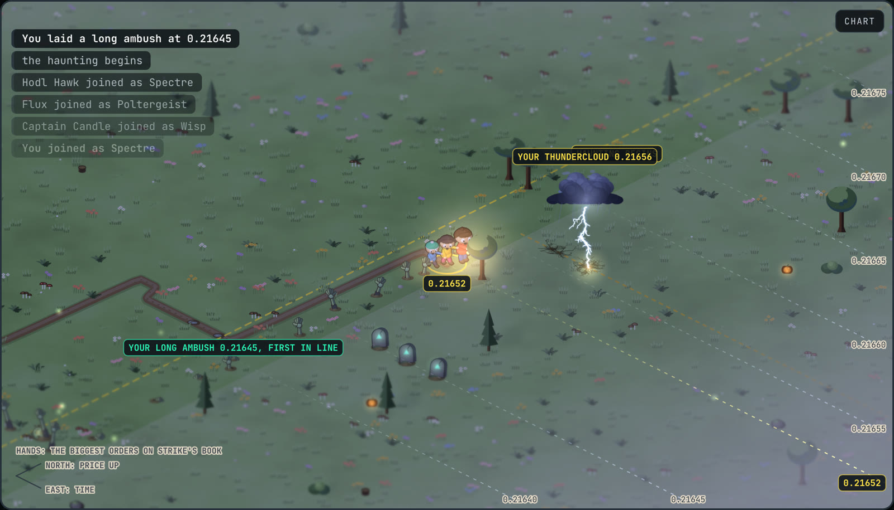

# Boltergeist



**Haunt the market on [Strike](https://strikefinance.org).** The price is a huddle of frightened kids with a
lantern, creeping east across a field at dusk, north when it rises and south when it falls, and the muddy
trail they leave is the chart. Pick a haunt and a ghost, then dig your graves: a line of them below the kids
to go long, north of them to go short, all in, with as much power as you dare. When the kids stray onto your
graves your ghosts swirl up out of them, you're in, and Strike pays you to be. Each round raises the least power you can call
with. Let the kids walk far enough back through your ghosts and they fade away, and you're knocked out. The
biggest gain at the final bell wins.

Boltergeist is a trading game that runs on Strike's live markets, built around Strike's maker rebate. An
line of graves is a maker order and a thundercloud is a maker exit, so a player who goes in at their graves and banks at a thundercloud is
paid by Strike both ways, where going in and out at the market pays the taker fee twice. Every price,
candle and market comes from Strike, and every position is worked out the way Strike would: its fees, its
smallest order, each market's leverage limits and margin tiers, and where it would be liquidated. Every
grave a player digs is liquidity waiting on the book. Play on paper, or **go live**: connect your wallet
and your graves and thunderclouds are real orders in Strike's book, and every call a real position.

## How it plays

- **Pick a haunt.** Haunts run on a clock, and each one is on a market the game picks, so everyone in it
  is on the same field. There's only ever one of each to join: the one that's on, while its doors are
  open in the first round, or else the next, where you wait in the lobby while the seats fill.

  | Haunt | Rounds | A new one | Doors open for |
  | --- | --- | --- | --- |
  | **Jump Scare** | five of two minutes | every 2 minutes, on the quickest crypto, like ETH, SOL, XRP and HYPE | 30 seconds |
  | **Haunting** | six of ten minutes | every 15 minutes, on crypto and TradFi like gold, NVDA and the S&P 500 | 5 minutes |
  | **Curse** | six of four hours | every 4 hours | 3 hours |

  Walk in late and the haunt is caught up from Strike's candles; you start from your stake like
  everyone else.

- **Pick your ghost.** Each one turns in drifting mist, drawn at thirty two angles so it spins
  smoothly, and spins up out of its grave the same way in the game. Your ghost's stake is your stack for the game, and the bigger the stake, the
  bigger the ghost: a Slime is a little blob of a ghost with a curling tail, a Spectre a hooded figure with
  glowing eyes, and a Boltergeist is Strike's own mascot, Bolt the mint dragon, come back as a ghost with a bolt of
  lightning circling it.

  | Ghost | Rank | Stake |
  | --- | --- | --- |
  | **Slime** | Confused | $10 |
  | **Spectre** | Restless | $50 |
  | **Boltergeist** | Furious | $250 |

  Every ghost haunts the same board, ranked on how far their stake has come, so a Slime that triples
  beats a Boltergeist up half. Everyone in a haunt gets the same power: the most the market allows a $250
  stake.

- **The field.** Time runs east and the price runs north and south, at a fixed scale, so a price is
  always the same line of ground and the view pans to keep the kids in the middle. Their trail is trodden into mud,
  and their feet keep pace with the ground: when the price barely moves they stand still and tremble. The
  land runs on past every edge of the screen, meadows of flowers, ferns and toadstools, dead trees and
  carved pumpkins, and the ground ahead of them is in haze that thickens into fog: nobody knows where
  they'll walk. Every word on it is laid on the ground like the markings on a pitch: the price just south of
  the kids' feet, the prices marked along their rows and fading into the past behind them, and the clock along
  the line of time they stand on. Pointing at the field shows, faintly, the graves or thundercloud a click would put there. Everything on it is clay, drawn in code: the kids and the ghosts are rounded parts
  lit in hard bands, so there are no image files. Under it all, a low horror score, and sounds made in the
  browser: thuds, the earth cracking open, wind and thunder.
- **Fair weather until you're in.** The field is clear and bright, with soft shadows lit from above. When your
  graves spring, rain sets in while you're in. The only lightning is your thundercloud's, and each strike
  throws hard, long shadows straight away from it.
- **Strike's order book, order by order.** Strike publishes its book at L3: every resting order, in the
  order it will fill. The field streams it live: the biggest orders waiting on Strike are zombie hands
  clawing up out of the ground on their prices' lines, in the candle the kids are walking through, and the
  bigger the order the further out of the ground it has dug; the very biggest put their heads out too. Hands
  rise as orders arrive and sink back as they're pulled or filled. As the kids walk on, each candle's biggest
  order stays where it was, so the ground behind them keeps a record of where the book's weight sat, and a
  puff of dust goes up as an order fills. Your graves and your thundercloud each take their
  place in Strike's line at their price.
- **Dig your graves.** Click the field below the kids to go LONG, above them to go SHORT. A line of graves waits on that line just ahead of the kids, set
  in the ground itself, so as the field moves on the one at the back sinks into the earth and a new one rises
  at the front: four at the least, more as you add power. Change your power while your graves wait and they're
  laid again at the new power. It springs when the price trades through it: your ghosts swirl up out of the
  graves and settle into a row, spaced so the biggest never crowd each other, and you're in, all in, at exactly your price,
  as a maker, and Strike pays you its 0.005% maker rebate. Click again to move it. All you choose is your
  **power** (leverage, up to 75x on the biggest markets); each round has a floor that rises as the game goes
  on. Everyone's graves show along the edge of the fog, so you can see where the crowd is waiting.
- **Summon a thundercloud.** Click across the kids from your graves or call and a
  thundercloud gathers over that line, keeping pace a little ahead of them and striking the line again and
  again, each strike leaving a spidery scorch on the ground, so the price you want out at is marked out for
  you. Each strike lights the field: the sun's soft shadows give way to long ones thrown away from it. When
  the kids walk into it, lightning comes down on them and you bank, as a maker again. Graves in and
  thundercloud out and Strike pays you both ways, so even the smallest move your way is a win.
- **Give up the ghost** to close a call at the price now (a taker exit). Close near the best price a call saw, for a
  good profit, and it's a **critical hit**.
- **The give up button** shows what you would walk away with right now, after every fee: Strike's fee to
  get in, its taker fee for closing at the market, and the builder fee when one is set. It starts below
  zero, so holding on is the default. **Your funds** are what you have, the way Strike shows equity. A
  thundercloud closes as a maker and earns the rebate instead. A line on the field marks where giving
  up starts to pay, fees and all.
- **K.O.** Calls are knocked out where Strike would liquidate them. The further the kids walk back through
  your ghosts the fainter they get, and at the K.O. price they're gone: it takes your whole stack and you're out.
- **No one is put out for waiting.** Rounds only raise the floor on power; nobody is eliminated at a
  round's end, so your graves can wait as long as it takes. The only way out before the bell is a K.O.
- **The final bell.** Whatever is still in a call comes out at the price. The biggest gain left standing is
  champion; then those who went out, the last to go first. Badges for a win, for surviving, and for
  critical hits. The debrief shows what you added to Strike's book and earned in maker rebates.

Keys: `escape` fills in your graves, `space` banks, `left` `right` power (with `shift`, by 5).

**Everyone in one game.** Every haunt has ten seats, and everyone who joins it is in the same one, on
the same board: players on paper, players live on Strike (tagged live), and, in the seats nobody takes,
players the game runs (tagged bot). The bots dig graves and summon thunderclouds, now and then charge in, bank and
get knocked out like everyone else, and they're seeded by the haunt, so every player sees the same bots make
the same calls. The board beside the field moves as it happens. Pick your name under the haunt button.

A game carries on when you go back to the start or close the page: open it again and it catches up on what
happened from Strike's candles and the game's record of everyone's moves.

### How the shared game works

Each player's browser runs the whole haunt itself, from Strike's prices. What it can't know is what the
other players do, so each call, bank and K.O. goes to a small record of moves for that haunt, kept in
DynamoDB by `app/api/arenas`, and every browser in the haunt reads it back every second and a half and
plays the moves in at the times they were made. The server stamps each move with its own time and checks
the price it was made at against Strike's mark price, so nobody can call at a price that wasn't there.
Players are a random secret kept in the browser; the server only ever sees a hash of it. Seats are
taken in a transaction, so a haunt never has more than ten players however many arrive at once. With no
game table configured, or the server down, every haunt is you and nine bots.

## Going live

Switch the header from **paper** to **live** and connect:

- **A wallet.** Ethereum (MetaMask, Rabby, Coinbase), Solana (Phantom, Solflare) or Cardano (Eternl, Lace,
  Nami and friends). Boltergeist makes a trading key in your browser, you sign one message, and Strike's
  Builder Connect links that key to your Strike account (making one if you're new). The key can trade but
  can't withdraw, and it never leaves your browser.
- **Or an API key** from Strike's API wallets page, pasted in once.

In a live game the market goes to isolated margin at your power, with your ghost's stake as the margin, so
a call can only ever lose its stake.

- **A line of graves** is a post-only limit order on the market's tick, so it can only ever go in as a maker: one
  the price is already through is turned away rather than filled as a taker. It springs when Strike fills
  it, not when the chart says so, and a partial fill has the rest taken off and goes in with what filled.
  Moving your graves takes the order off Strike and places it again; filling them in cancels it.
- **A thundercloud** is a reduce-only limit order for the whole position, placed the moment the graves
  fills (or when you summon it on a call). It banks when Strike fills it. One the price has already passed fills at
  once, at that price or better, and as a taker, so the game counts the fee Strike charged.
- **Banking** closes reduce-only at the market, as a taker, and any thundercloud out comes off first.

Where a call went in and where it's knocked out are Strike's. The final bell takes off anything still
resting and closes what's open. A position Strike liquidates knocks you out of the game. The
bots stay pretend. Boltergeist adds no fee of its own to anything.

Every request is signed in the browser with Ed25519 and sent straight to Strike: there is no server in
between holding keys.

## How it uses Strike

| What | Strike API |
| --- | --- |
| Live mark prices for every market, every 3 seconds | WebSocket `/ws/price`, channel `!markprice@arr` |
| 24h moves for each haunt's market | WebSocket channel `!miniticker@arr` |
| Markets, tick sizes, smallest orders | `GET /price/v2/exchangeInfo` |
| Leverage limits and margin tiers per market | `GET /v2/markets` |
| Candles for the chart and catching up a game | `GET /price/v2/klines?priceType=mark` |
| Wallet sign-in | Builder Connect: `POST /auth/builder/request-signature`, `/auth/builder/verify-signature` |
| Live graves and thunderclouds | `POST /v2/order` (limit, post-only for graves, reduce-only for thunderclouds), `DELETE /v2/order/cancel`, `GET /v2/order`, `/v2/history/fill` |
| Live charges and banks | `POST /v2/marginMode`, `/v2/leverage`, `/v2/order` (market, reduce-only to close), `GET /v2/order`, `/v2/positions` |
| Balance | `GET /v2/account` |
| Checking every move's price in the shared game | `GET /price/v2/markPrice` |
| The order book, order by order: the hands and your place in line | L3: `GET /v2/l3/snapshot` (through `/api/l3`, as it has no CORS headers), then WebSocket `/ws/l3`, channel `{symbol}@l3`, each update in sequence |

Calls are knocked out on the **mark price**, the same price Strike liquidates on.

## Run it

Needs Node 22.18 or newer.

```bash
npm install
npm run dev
```

Then open http://localhost:3000. It starts on paper with Strike's mainnet prices. Settings live in
`.env.local` (see `.env.example`):

| Setting | What |
| --- | --- |
| `NEXT_PUBLIC_STRIKE_NETWORK` | `mainnet` (the default) or `testnet` |
| `NEXT_PUBLIC_BUILDER_CODE` | Your Strike builder code, for wallet sign-in |
| `NEXT_PUBLIC_BUILDER_FEE_BPS` | An optional builder fee on live charges and banks, 0 to 100 basis points. Unset, there is none |
| `NEXT_PUBLIC_STRIKE_APP_URL` | Where players go to deposit |
| `ARENAS_TABLE` | The arena's DynamoDB table. `boltergeist-arenas-dev` for local dev and previews, `boltergeist-arenas` in production |
| `AWS_ROLE_ARN` | On Vercel: the role for the deployment's environment (the stack's outputs). Locally, leave it unset and use `AWS_PROFILE` |
| `DYNAMODB_ENDPOINT` | DynamoDB Local instead of AWS |

`npm test` runs the game engine's tests and the live desk against a stand-in for Strike, `npm run test:db` runs the
arena against DynamoDB Local in Docker, `npm run check` typechecks, `npm run lint` lints.

## Hosting

The app runs on Vercel. The arena's tables are in AWS, in one CDK stack, `BoltergeistStack` (`infra/`):

| Resource | Name | Notes |
| --- | --- | --- |
| DynamoDB | `boltergeist-arenas` | Production. Paid per request, at most 400 reads and 100 writes a second: past that requests are throttled, not charged. Each haunt's items go a day after it ends |
| DynamoDB | `boltergeist-arenas-dev` | Local dev and Vercel previews |
| IAM role | `boltergeist-vercel-production` | Assumed by production's functions with Vercel's OIDC token: no AWS keys are stored on Vercel |
| IAM role | `boltergeist-vercel-preview` | The same for previews and `vercel dev`, on the dev table |
| Budget | `boltergeist-monthly` | Emails at 50, 80 and 100% of the month's budget, counting only resources tagged `project=boltergeist` |
| Alarm | `boltergeist-arenas-throttled` | Emails when the production table turns requests away at its ceiling |

```bash
cd infra
cp .env.example .env    # the alert email, the budget, the Vercel team and project
npm install
npx cdk deploy          # with AWS_PROFILE set to the account's profile
```

Then on the Vercel project set `ARENAS_TABLE` and `AWS_ROLE_ARN` for production and preview from the stack's outputs.
Each alert address gets a "Confirm subscription" email from AWS on the first deploy. The budget's filter only works
once `project` is an active cost allocation tag (Billing, Cost allocation tags).

The firewall rate limits the arena's routes and the order book route per address. Its rules are in `deploy/vercel-firewall.json`;
`node deploy/firewall.mjs` compares them with the live firewall and `node deploy/firewall.mjs apply` publishes them.

`deploy/ship.sh` checks what's committed (types, lint, tests) and deploys a clean copy of it to production.

## Layout

| Path | What |
| --- | --- |
| `lib/game/war.ts` | The game: the haunt clock and each haunt's market, the lobby, rounds, floors, calls with Strike's fees and liquidation, banking, K.O.s, seeded bots, the final bell, standings |
| `lib/game/useWar.ts` | Your games in the browser, moved on by each price, the clock and the other players' moves, caught up on opening |
| `lib/online.ts`, `lib/server/arenas.ts`, `app/api/arenas/` | The shared game: who's in each haunt and the record of their moves |
| `infra/` | The AWS stack: the game's tables, the Vercel roles, the budget and alarm |
| `deploy/` | Shipping to Vercel, and the firewall's rules |
| `lib/strike.ts` | Strike's public API: markets, candles, and the live price stream |
| `lib/live/` | Going live: request signing, wallets, Builder Connect, and the desk that turns calls into positions |
| `lib/live/l3.ts`, `lib/live/book.ts`, `app/api/l3/` | Strike's L3 book kept live from a snapshot and every update after it, and your place in its line |
| `components/Base.tsx`, `components/Arena.tsx` | The start (pick a haunt and a ghost), and a game's screen |
| `components/Connect.tsx` | Connecting a wallet or an API key |
| `components/Field.tsx` | The field: the price as frightened kids with a lantern crossing an isometric field at dusk, the weather by round, your ghosts and thundercloud, Strike's biggest orders as zombie hands rising and sinking at each candle, drawn on a canvas |
| `components/Chart.tsx` | Colours and price steps shared with the field, and a candle chart |
| `components/clay.ts`, `components/Spirit.tsx` | The clay kids and the three ghosts, ray cast from rounded parts, and the ghosts' portraits |
| `components/art/` | The logo and older SVG art |

## Next

- **Strike's user stream** for fills, instead of asking after each resting order every second.
- **Separate boards for live and paper**, once there are enough players for both.
- **Deposits in the app**, through Builder Connect's deposit flow.
- **Leaderboards and clans** built on Strike's trader stats.

MIT licensed.

## Credits

Music: "Horror" by drakzlin. Coin marks: cryptocurrency-icons, public domain (CC0).
